# Dynamight

A self-hosted backup management system with a web UI, supporting multiple destinations including local drives, cloud storage, SFTP, and WebDAV.


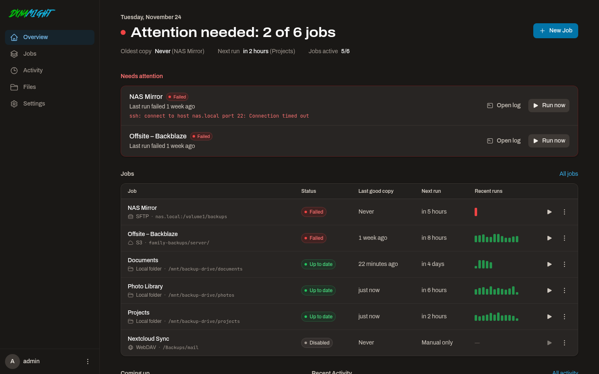

## Features

- **Multiple Backup Destinations**
  - Local/USB drives with auto-mount support
  - AWS S3 and S3-compatible (MinIO, Backblaze B2, DigitalOcean Spaces)
  - Google Drive (including shared drives)
  - Microsoft OneDrive
  - SFTP/SSH servers
  - WebDAV (Nextcloud, ownCloud)

- **Job Management**
  - Create, edit, clone, and delete backup jobs
  - Guided step-by-step setup for new jobs (can be turned off for the full form)
  - A page per job with a summary sentence, recent runs, schedules, sources and destination
  - Multiple source directories per job
  - Cron-based scheduling (daily, weekly, monthly, custom) with timezone support
  - Manual and scheduled execution
  - Real-time log streaming via WebSocket

- **Directory Compression**
  - Archive source directories (tar.gz or zip) before uploading
  - Optional archive encryption (AES-256-CBC via openssl, `.enc` files)
  - Timestamped versioning with configurable per-directory retention
  - Custom archive name prefixes
  - Store-only mode (archive without compression)

- **Job List**
  - Table or card view, sortable, with filters by state (needs attention, running, OK, disabled)
  - Recent runs of each job at a glance
  - Human-readable schedule display ("Daily at 14:30")

- **Monitoring & History**
  - Overview showing jobs that need attention (last run failed, or no successful backup for twice the schedule interval) with the reason, the oldest backup and the next scheduled runs
  - Notifications via [ntfy](https://ntfy.sh) and a generic JSON webhook for failed, overdue, recovered and (optionally) every successful run
  - Free-space indicators for local destinations
  - Activity list of all runs, grouped by day, with the error line of failed runs and status, job, and date-range filters
  - Log viewer for every run (live while running, stored afterwards) with search, level filter, copy and download
  - Configurable history retention

- **File Browser**
  - Browse allowed local paths and USB drives directly in the UI
  - Grid and list views, search, sortable columns, file type column
  - Lazy-loaded directory sizes
  - Create folders; deleting requires password re-verification

- **Configuration Backup & Restore**
  - Export jobs, credentials, schedules, and settings as an encrypted `.dmbackup` file
  - Import with **Merge** or **Replace All** strategy, with a preview before applying
  - Restore directly from the initial setup screen when moving to a new server

- **Personalization**
  - Works on phones (bottom tab bar), tablets and desktops
  - Light and dark mode
  - Three base tones (Paper, Cloud, Slate) and six accent colors
  - English and German UI

- **Security**
  - Two-factor authentication (TOTP)
  - AES-256-GCM encrypted credential storage
  - Rate limiting with exponential backoff
  - Argon2 password hashing
  - Secure httpOnly cookies

- **Lightweight**
  - Single binary + SQLite
  - Runs in ~50MB RAM
  - ~80MB Docker image
  - Graceful shutdown on `SIGTERM`/`SIGINT`

## Screenshots

All screenshots show the dark theme; light mode, three base tones and six accent colours are available.

| | |
|---|---|
| **Overview** — what needs attention and why, every job with its recent runs, what runs next | **Job list** — sortable table, filters by state |
|  | 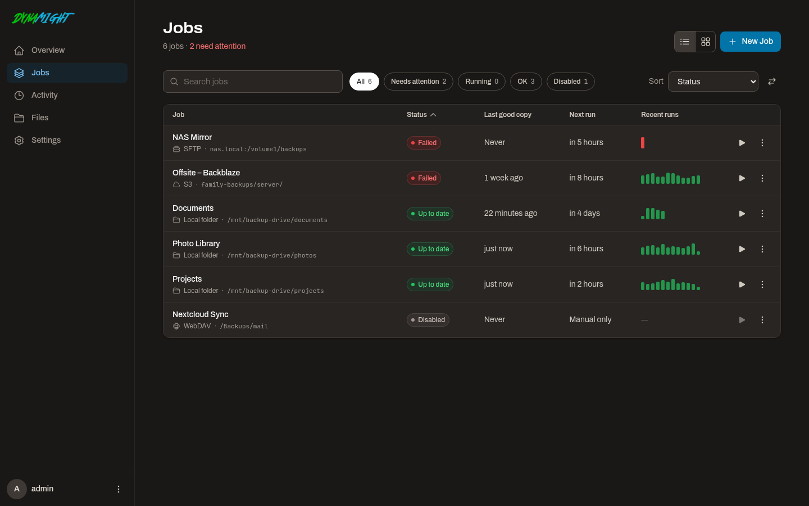 |
| **Job page** — summary sentence, run history, schedules, sources and destination | **Job settings** — all options in sections, with a save bar |
| 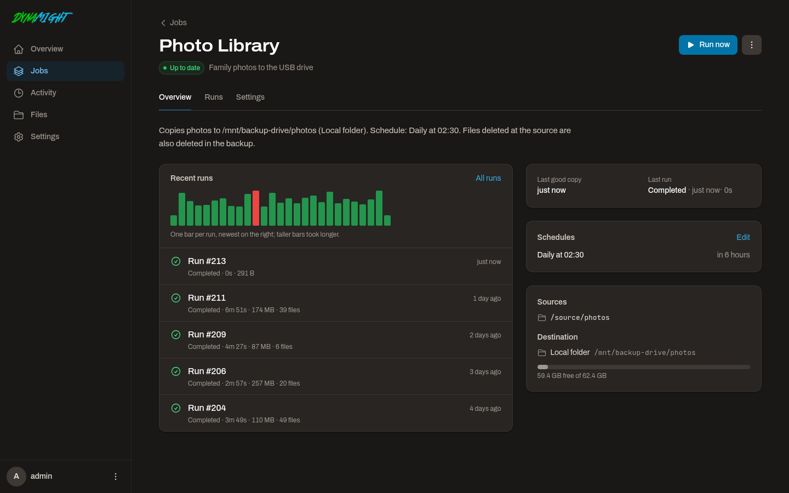 | 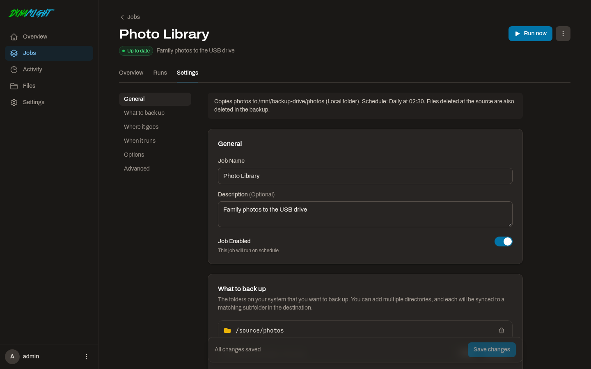 |
| **Guided setup** — new jobs step by step | **Activity** — every run, grouped by day, with the reason of failures |
| 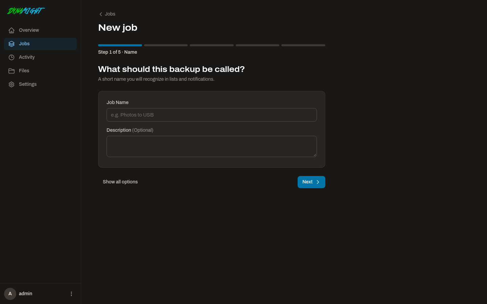 | 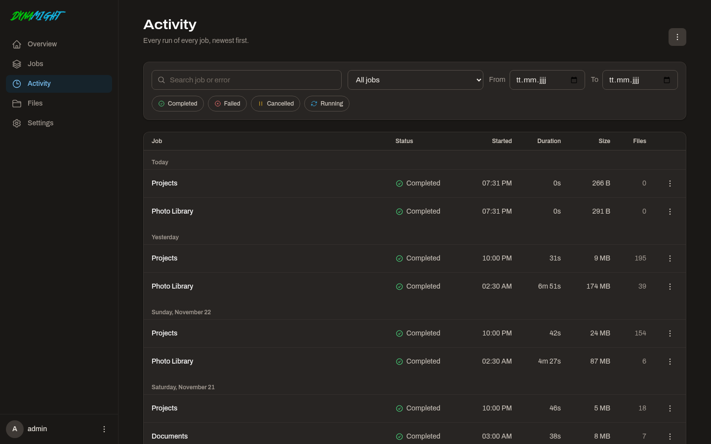 |
| **Run log** — live while running; search, level filter, copy, download | **File browser** — allowed paths and USB drives |
| 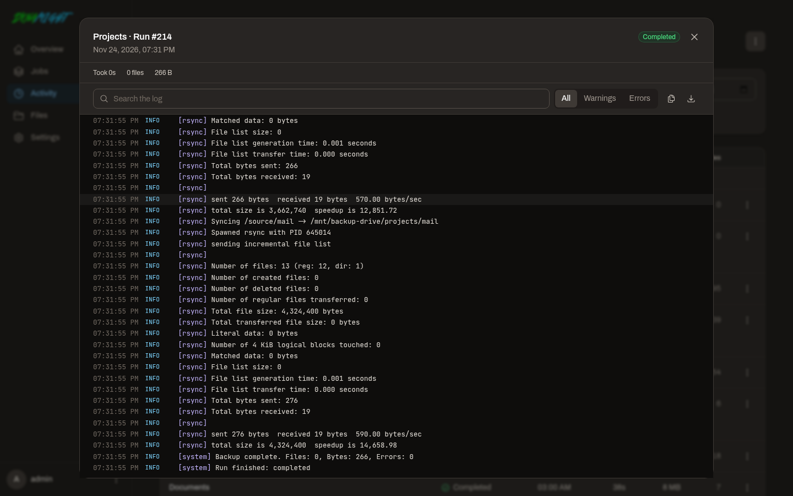 | 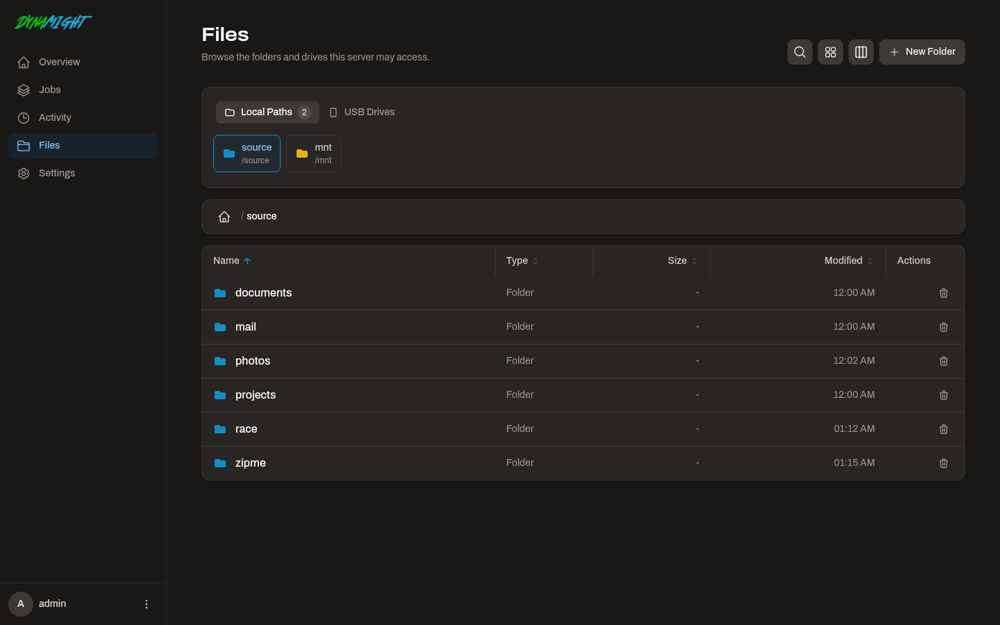 |
| **Settings** — notifications, credentials, account, security, appearance, data | **On a phone** — bottom tab bar, cards instead of tables |
| 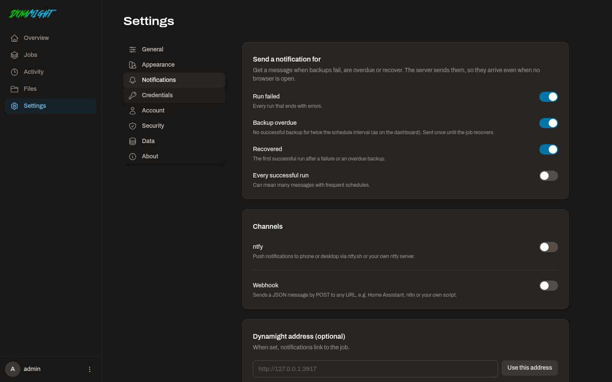 | 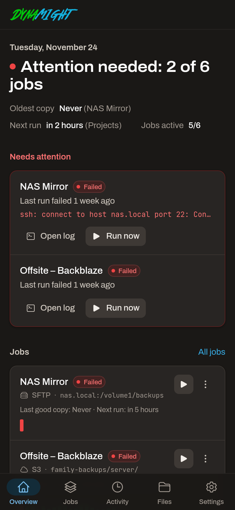 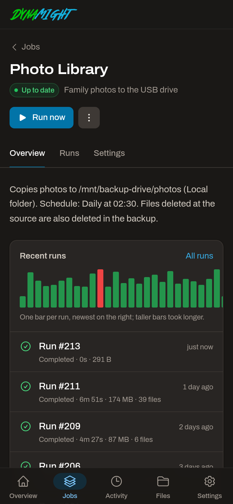 |

## Supported Providers

| Provider | Description | Authentication |
|----------|-------------|----------------|
| Local/USB | Rsync to local or mounted drives | None |
| AWS S3 | S3 and S3-compatible storage | Access Key + Secret |
| Google Drive | Google Drive folders and shared drives | OAuth2 (own client ID + secret, refresh token) |
| OneDrive | Microsoft OneDrive personal/business | OAuth2 (own client ID, refresh token) |
| SFTP | SSH/SFTP servers | Password or SSH Key |
| WebDAV | Nextcloud, ownCloud, generic WebDAV | Username + Password |

## Quick Start

### Using Docker (Recommended)

```bash
# Create a directory for Dynamight
mkdir dynamight && cd dynamight

# Download the example config and docker-compose file
curl -O https://raw.githubusercontent.com/moonwhaler/dynamight/main/dynamight.toml.example
curl -O https://raw.githubusercontent.com/moonwhaler/dynamight/main/docker-compose.yml

# Create your configuration
cp dynamight.toml.example dynamight.toml

# Set a secure JWT secret (required)
NEW_SECRET=$(openssl rand -base64 32)
sed -i "s|CHANGE-ME-generate-with-openssl-rand-base64-32|${NEW_SECRET}|" dynamight.toml

# Without HTTPS in front (plain http://server:8080), also set
# secure_cookies = false in dynamight.toml, or the browser drops the login cookie

# Start the container
docker compose up -d
```

Access the UI at **http://localhost:8080** and complete the setup wizard to create your admin account.

### Docker Compose Configuration

```yaml
services:
  dynamight:
    image: ghcr.io/moonwhaler/dynamight:latest
    container_name: dynamight
    restart: unless-stopped
    stop_grace_period: 30s              # time for running backups to stop cleanly
    cap_add:
      - SYS_ADMIN
    devices:
      - /dev:/dev
    ports:
      - "8080:8080"
    volumes:
      - type: bind                      # fails clearly if dynamight.toml is missing
        source: ./dynamight.toml
        target: /app/config/dynamight.toml
        read_only: true
        bind:
          create_host_path: false
      - dynamight-data:/app/data
      - dynamight-logs:/app/logs
      - /mnt:/mnt:rshared
      # Add your backup sources (read-only recommended):
      # - /home:/source/home:ro
      # - /var/www:/source/www:ro
    environment:
      - RUST_LOG=${RUST_LOG:-info,dynamight=debug}
      # - TZ=Europe/Berlin              # overrides server.timezone from dynamight.toml
    security_opt:
      - no-new-privileges:true
      # - apparmor=unconfined           # needed where AppArmor blocks mount (Ubuntu, Debian)

volumes:
  dynamight-data:
  dynamight-logs:
```

### Podman

The image and `docker-compose.yml` also work with Podman (`podman compose up -d`). Mounting USB drives needs real root, so run the container rootful (`sudo podman compose up -d`); rootless Podman cannot mount block devices. Backups to remote destinations and already-mounted paths work rootless too.

## Configuration

Configuration is done via a TOML file (`dynamight.toml`). Environment variables can override any setting.

### Configuration File

Copy `dynamight.toml.example` to `dynamight.toml` and edit:

```toml
[security]
jwt_secret = "your-secret-here"  # Generate with: openssl rand -base64 32
secure_cookies = true
allowed_browse_paths = ["/mnt", "/home", "/media"]

[server]
host = "0.0.0.0"
port = 8080

[database]
url = "sqlite:data/dynamight.db"
```

See `dynamight.toml.example` for all available options with detailed documentation.

### Configuration Priority

1. **Environment variables** (highest priority) - for Docker/CI overrides
2. **Config file** (`dynamight.toml`)
3. **Built-in defaults** (lowest priority)

### Config File Search Paths

1. `DYNAMIGHT_CONFIG` environment variable (if set)
2. `./dynamight.toml` (current directory)
3. `/etc/dynamight/dynamight.toml` (system-wide)

### Environment Variable Overrides

Any setting can be overridden via environment variables using SCREAMING_SNAKE_CASE:

| Setting | Environment Variable |
|---------|---------------------|
| `security.jwt_secret` | `JWT_SECRET` |
| `server.host` | `HOST` |
| `server.port` | `PORT` |
| `database.url` | `DATABASE_URL` |
| `security.allowed_browse_paths` | `ALLOWED_BROWSE_PATHS` (comma-separated) |

### Key Settings

| Setting | Default | Description |
|---------|---------|-------------|
| `security.jwt_secret` | **required** | Secret for JWT signing and credential encryption. Changing it logs everyone out and makes stored credentials unreadable (re-enter them, or restore a configuration backup after the change) |
| `server.host` | `0.0.0.0` | Network interface to bind |
| `server.port` | `8080` | Port to listen on |
| `database.url` | `sqlite:data/dynamight.db` | SQLite database location |
| `security.secure_cookies` | `true` | Require HTTPS for cookies |
| `security.allowed_browse_paths` | `["/mnt", "/home", "/media"]` | Paths users can browse |
| `rate_limit.max_attempts` | `5` | Max failed auth attempts before lockout |

### Notifications

Set up under **Settings → Notifications**. The server sends them, so they arrive without an open browser. Choose the events (run failed, backup overdue, recovered, every successful run) and one or both channels:

- **ntfy**: server (default `https://ntfy.sh`), topic and an optional access token. On a public server anyone who knows the topic can read it, so pick a hard-to-guess topic or use a token.
- **Webhook**: any URL, with an optional `Authorization` header. Dynamight POSTs JSON:

```json
{
  "event": "failed",
  "title": "Backup failed: Photos",
  "message": "Run #12 failed in 3m 12s. 0 file(s), 0 B transferred, 1 error(s).\nLast error: …",
  "timestamp": "2026-11-24T02:03:12Z",
  "url": "https://backup.example.com/#/jobs/3",
  "job": { "id": 3, "name": "Photos" },
  "run": { "id": 12, "status": "failed", "started_at": "…", "completed_at": "…",
           "files_transferred": 0, "bytes_transferred": 0, "error_count": 1 }
}
```

`event` is `failed`, `overdue`, `recovered`, `success` or `test`; `run` is `null` for `overdue` and `test`. A backup is overdue when the last successful run is more than twice the longest gap of the job's most frequent schedule ago (plus an hour); this is sent once, and "recovered" follows the next successful run. **Send test** tries the values in the form without saving them. Set the Dynamight address to make notifications link to the job.

## Local Development

### Prerequisites

- **Rust** 1.83+ ([rustup.rs](https://rustup.rs))
- **Node.js** 20+ ([nodejs.org](https://nodejs.org))
- **rsync** (usually pre-installed on Linux)

### Quick Start

```bash
# Start both backend and frontend with one command
./scripts/dev.sh
```

This will:
- Check dependencies
- Create `dynamight.toml` from `dynamight.toml.example` with a random JWT secret
- Install frontend npm packages
- Start backend on http://localhost:3000
- Start frontend dev server on http://localhost:5173 (with hot-reload)

### Manual Setup

#### Backend

```bash
# Create config file in project root
cp dynamight.toml.example dynamight.toml

# Edit dynamight.toml and set jwt_secret
# Or generate one: openssl rand -base64 32

# Create data directory
mkdir -p data

# Run the backend
cd backend
cargo run
```

#### Frontend

```bash
cd frontend
npm install
npm run dev
```

### Running Tests

```bash
# Backend (Rust)
cargo test

# Frontend (Vitest)
cd frontend
npm test
```

The remote providers (S3, SFTP, WebDAV) also have live tests that run against real servers. They are ignored by default; `backend/tests/providers_live.rs` explains how to start local test servers (rclone for WebDAV and SFTP, SeaweedFS for S3) and run them with `cargo test --test providers_live -- --ignored`.

## Building for Production

### Using Build Script

```bash
./scripts/build.sh
```

Creates `dist/dynamight-<version>.tar.gz` (plus a `.sha256` checksum) containing:
- Compiled binary (release mode) and a `VERSION` file
- Frontend static files
- Migrations
- Configuration template and systemd unit
- Install and update scripts

The version comes from `backend/Cargo.toml`; bump it with `./scripts/version.sh patch|minor|major`, which also updates `Cargo.lock` and the frontend's `package.json`/`package-lock.json`. Builds use `npm ci` and `cargo build --locked`, so the lockfiles must be current.

### Building Docker Image

```bash
# Build locally
docker build -t dynamight .

# Or use the build script (builds native package + Docker image)
./scripts/build.sh

# Build and push to registry (:latest and :<version>)
./scripts/build.sh --docker-only --push
```

The script uses Docker when its daemon is running and Podman otherwise (force one with `CONTAINER_ENGINE=podman`). With Podman it builds in Docker image format, since the OCI format drops the `HEALTHCHECK`. It checks that the image starts and reports the expected version. It refuses to push an image built from uncommitted changes unless `ALLOW_DIRTY=1` is set.

## Server Deployment

### Using Install Script

```bash
# Extract package
tar -xzf dynamight-*.tar.gz
cd dynamight-*

# Install as system service
sudo ./scripts/install.sh
```

This will:
- Check that the binary runs on this system and that `rsync` and `mount` are present (and warn about missing optional tools such as `mkfs.exfat` or `ntfs-3g`)
- Install binary to `/opt/dynamight`
- Create config at `/etc/dynamight/dynamight.toml` (with auto-generated JWT secret and the system's timezone)
- Set up data directory at `/var/lib/dynamight`
- Install the systemd service (it runs as root, which mounting drives requires)

If Dynamight is already installed, the script stops and points to `update.sh`.

If you open the web UI over plain HTTP from another machine, set `secure_cookies = false` in the config, or the browser drops the login cookie.

Then configure and start:

```bash
# Review/edit configuration (optional - defaults are sensible)
sudo nano /etc/dynamight/dynamight.toml

# Enable and start service
sudo systemctl enable dynamight
sudo systemctl start dynamight

# Check status
sudo systemctl status dynamight

# View logs
journalctl -u dynamight -f
```

### Updating

```bash
tar -xzf dynamight-<new-version>.tar.gz
cd dynamight-<new-version>
sudo ./scripts/update.sh
```

The update script:
- Checks that the new binary runs on this system before touching anything
- Warns if backup runs are still in progress (when `sqlite3` is installed)
- Stops the service, then backs up the program files and both databases to `/opt/dynamight-backups/<timestamp>` (the last 3 are kept)
- Installs the new files and waits until `/api/system/health` reports the new version (needs `curl` or `wget`; otherwise it only checks that the service stays up)
- Restores the previous version and its databases automatically if the new one does not come up, or if anything fails or is interrupted along the way

```bash
sudo ./scripts/update.sh list                  # Show backups
sudo ./scripts/update.sh rollback              # Back to the previous version (keeps current data)
sudo ./scripts/update.sh rollback --with-data  # ...and reset the databases to that backup
sudo ./scripts/update.sh --force               # Do not ask (e.g. reinstalling the same version)
```

### Uninstalling

```bash
sudo ./scripts/install.sh uninstall
```

## Usage Guide

### Creating a Backup Job

Click **New Job** on the Overview or Jobs page. New jobs are set up in five steps:

1. **Name**: a short name and an optional description
2. **Sources**: one or more folders to back up (browse or type the path). Files or folders to leave out can be added here too
3. **Destination**: the type and where the copies go
   - **Local/USB**: mount point and subdirectory; with a USB drive selected, mount it before and unmount it after the backup
   - **S3**: bucket, region, prefix, endpoint (for S3-compatible services)
   - **Google Drive**: folder ID, shared drive ID (optional)
   - **OneDrive**: folder path, drive ID (optional)
   - **SFTP**: host, port, username, remote path, password or key
   - **WebDAV**: URL, remote path

   Remote destinations need stored credentials; pick them here or add new ones. **Test connection** checks the settings before saving
4. **Schedule**: one or more times (daily, weekly, monthly, an interval or a cron expression). Skip it for a job that only runs when you start it
5. **Review**: a summary of what the job will do, mirror mode and the space check. **Create job** saves it

**Show all options** switches to the full form at any step, keeping what you entered. To always use the full form, turn off **Settings → General → Guided job setup**. Copies of a job (**Clone** in its menu) open in the full form.

The full form, also used to change a job later (its **Settings** tab), has these sections:

- **General**: name, description, enabled
- **What to back up**: source folders, exclude patterns and folders, **Archive sources** (see below)
- **Where it goes**: destination and credentials
- **When it runs**: schedules
- **Options**: mirror mode (delete files from the backup that were deleted at the source) and the space check
- **Advanced**: dry run, checksum comparison, always transfer (ignore timestamps), compress during transfer, log detail, bandwidth limit

**Archive sources** packs each source folder into an archive before the transfer:

- Set a staging path (temporary directory for the archives)
- Choose the format (tar.gz or zip), optionally without compression
- Add a timestamp to keep versions, and set how many to keep
- Optionally set a password. Archives are then encrypted with AES-256-CBC and get a `.enc` suffix (`.tar.gz.enc`, `.tar.enc` or `.zip.enc`). Decrypt one with `openssl enc -d -aes-256-cbc -pbkdf2 -in photos_1.tar.gz.enc -out photos_1.tar.gz`

### Managing Credentials

Credentials for cloud providers are stored encrypted. Manage them in Settings:

1. Open **Settings → Credentials**
2. Add, edit, or delete credentials
3. View which jobs use each credential

When editing an OAuth credential, fields left empty keep their stored values.

### How Cloud Sync Works

All remote providers (S3, SFTP, WebDAV, Google Drive, OneDrive) sync incrementally. Each run lists the destination first and only uploads files that are new, changed in size, or modified locally after the copy on the destination. Files are streamed from disk, so large files do not have to fit into memory. S3 uses multipart upload for files above 64 MiB, and Google Drive and OneDrive use resumable chunked uploads.

With **Delete extraneous files** enabled, files that no longer exist in the source are removed from the destination. Google Drive moves them to the trash, and OneDrive moves them to the recycle bin. Files that match an exclude pattern are never deleted. Throttled requests (HTTP 429) and temporary server errors are retried, honoring `Retry-After`.

Notes per provider:

- **S3-compatible services**: with a custom endpoint, path-style addressing is used and the SDK only sends checksums where an operation requires them, because not every S3-compatible service accepts the newer checksum headers.
- **OneDrive**: names OneDrive does not allow (for example ones containing `" * : < > ? \ |`, or `desktop.ini`) are skipped with a warning.
- **SFTP**: the host key fingerprint is shown in OpenSSH format (`ssh-keygen -lf`), so you can compare it directly.

### Setting Up Google Drive and OneDrive

Dynamight uses your own OAuth app registration and renews access tokens itself with the refresh token, so scheduled backups keep working after the access token expires (about one hour).

**Google Drive**

1. In the Google Cloud Console, create a project, enable the **Google Drive API** and configure the OAuth consent screen.
2. Set the consent screen's publishing status to **In production**. While it is in "Testing", Google expires refresh tokens after 7 days.
3. Create an **OAuth client ID** and note the client ID and client secret.
4. Run the OAuth authorization-code flow once with offline access (`access_type=offline`) to get a refresh token, for example with the OAuth 2.0 Playground configured to use your own client.
5. Scope: with `https://www.googleapis.com/auth/drive.file`, Dynamight can only see files and folders it created itself. Leave the folder ID empty (or use a folder Dynamight created) in that case. To back up into an existing folder, use the `https://www.googleapis.com/auth/drive` scope, which Google classifies as restricted.
6. In Dynamight, add a Google Drive credential with the client ID, client secret and refresh token. The access token is optional.

**OneDrive**

1. Register an app in the Microsoft Entra admin center and add the delegated Microsoft Graph permissions `Files.ReadWrite.All` and `offline_access`.
2. Run the authorization-code flow once to get a refresh token.
3. In Dynamight, add a OneDrive credential with the application (client) ID and the refresh token. The client secret is only needed for confidential (web) app registrations. Set the tenant to `consumers` for personal Microsoft accounts if `common` does not work for your registration.

### Scheduling Backups

Schedules are part of a job: open the job, go to its **Settings** tab and the **When it runs** section (or click **Edit** next to the schedules on the job's overview).

1. Click **Add Schedule**
2. Choose a type:
   - **Daily**: every day at a time
   - **Weekly**: on chosen weekdays at a time
   - **Monthly**: on a day of the month at a time
   - **Interval**: every few minutes or hours
   - **Custom**: a cron expression, checked by the server
3. Click **Add Schedule**, then **Save changes**

A schedule can be paused with its switch. The same schedule cannot be added twice. Times are in the server's timezone (see below); when your browser is in another zone, the zone is shown next to the times.

### Two-Factor Authentication

Enable 2FA for additional security:

1. Open **Settings → Security**
2. Click **Enable 2FA**
3. Scan QR code with authenticator app
4. Enter verification code
5. Save recovery codes

### Finding Your Way Around

- **Overview**: what needs attention, all jobs with their recent runs (each bar is one run; click it for its log), and what runs next
- **Jobs**: all jobs as a table or cards; filter by state and sort by name, status, last good copy or next run. Each job has its own page with **Overview**, **Runs** and **Settings** tabs
- **Activity**: every run of every job, newest first, grouped by day
- **Files**: browse allowed paths and USB drives
- **Settings**: general behaviour, appearance, notifications, credentials, account, two-factor authentication, data (run history retention, configuration backup) and version information

Unsaved changes to a job are kept until you save or discard them; leaving the page asks first.

### Backing Up and Restoring the Configuration

Move your setup to another server, or keep a safe copy of it:

1. Open **Settings → Data**
2. **Export**: set an encryption password (min. 8 characters) and download the `.dmbackup` file
3. **Import**: select a `.dmbackup` file, enter its password, choose **Merge** (keep existing items, add new ones) or **Replace All**, and review the preview before applying

On a fresh installation, the setup screen also offers to restore from a backup. OAuth credentials (Google Drive, OneDrive) may need to be re-authenticated after a restore.

The file can also be decrypted manually:

```bash
openssl enc -d -aes-256-cbc -salt -pbkdf2 -iter 600000 -md sha256 -in backup.dmbackup
```

### Appearance and Language

- Open **Settings → Appearance** to switch between light and dark mode, pick a base tone (Paper, Cloud, Slate) and an accent color, and change the UI language (English, German)
- The menu next to your user name at the bottom of the sidebar switches between light and dark mode in one click

Both are stored per browser.

### Scheduling with Timezones

Schedules run according to the server's configured timezone (`server.timezone` in `dynamight.toml` or the `TZ` environment variable). Set this to your local timezone (e.g. `Europe/Berlin`, `America/New_York`) so that "Daily at 03:00" means 3 AM local time, not UTC.

## Architecture

```
┌─────────────────┐     ┌─────────────────────────────┐     ┌────────────┐
│   Browser       │────▶│   Axum Server               │────▶│  SQLite    │
│   (Svelte SPA)  │◀────│   (Rust)                    │◀────│            │
└─────────────────┘     └──────────┬──────────────────┘     └────────────┘
                                   │
                                   ▼
                        ┌─────────────────────────────┐
                        │   Provider Layer            │
                        │   ┌─────┐ ┌────┐ ┌──────┐  │
                        │   │Rsync│ │ S3 │ │GDrive│  │
                        │   └─────┘ └────┘ └──────┘  │
                        │   ┌──────┐ ┌────┐ ┌──────┐ │
                        │   │OneDrv│ │SFTP│ │WebDAV│ │
                        │   └──────┘ └────┘ └──────┘ │
                        └─────────────────────────────┘
```

- **Backend**: Rust with Axum framework, SQLite databases (main + logs)
- **Frontend**: Svelte 5 SPA with Tailwind CSS; fonts are bundled, nothing is loaded from other servers
- **Communication**: REST API + WebSockets for live logs and run start/finish events
- **Providers**: Trait-based abstraction for multiple destinations

See [docs/project-description.md](docs/project-description.md) for detailed architecture documentation.

For complete API documentation, see [docs/API.md](docs/API.md).

## API Reference

### Authentication

| Endpoint | Method | Description |
|----------|--------|-------------|
| `/api/auth/setup-required` | GET | Check if setup needed |
| `/api/auth/setup` | POST | Initial admin setup |
| `/api/auth/setup-from-backup` | POST | Initial setup from a configuration backup |
| `/api/auth/login` | POST | Authenticate user |
| `/api/auth/logout` | POST | End session |
| `/api/auth/me` | GET | Get current user |
| `/api/auth/change-password` | POST | Change password |

### 2FA / TOTP

| Endpoint | Method | Description |
|----------|--------|-------------|
| `/api/auth/totp/setup` | POST | Generate TOTP secret |
| `/api/auth/totp/enable` | POST | Enable 2FA |
| `/api/auth/totp/disable` | POST | Disable 2FA |
| `/api/auth/totp/validate` | POST | Validate TOTP code |
| `/api/auth/totp/recovery` | POST | Use recovery code |
| `/api/auth/totp/status` | GET | Get 2FA status |

### Jobs

| Endpoint | Method | Description |
|----------|--------|-------------|
| `/api/jobs` | GET | List all jobs |
| `/api/jobs` | POST | Create job |
| `/api/jobs/:id` | GET | Get job details |
| `/api/jobs/:id` | PUT | Update job |
| `/api/jobs/:id` | DELETE | Delete job |
| `/api/jobs/:id/run` | POST | Run job |
| `/api/jobs/:id/cancel` | POST | Cancel running job |
| `/api/jobs/:id/clone` | POST | Clone job |
| `/api/jobs/:id/check-space` | POST | Check free space at the destination |

### Schedules

| Endpoint | Method | Description |
|----------|--------|-------------|
| `/api/jobs/:id/schedules` | GET | List job schedules |
| `/api/jobs/:id/schedules` | POST | Create schedule |
| `/api/schedules/validate` | POST | Check a cron expression and return its next run |
| `/api/schedules/:id` | PUT | Update schedule |
| `/api/schedules/:id` | DELETE | Delete schedule |

### Runs & Logs

| Endpoint | Method | Description |
|----------|--------|-------------|
| `/api/jobs/:id/runs` | GET | List job runs |
| `/api/jobs/:id/runs` | DELETE | Delete all runs of a job |
| `/api/runs` | GET | Recent runs of all jobs (`limit`, `before`, `job_id`, `status`, `from`, `to`) |
| `/api/runs` | DELETE | Delete all runs |
| `/api/runs/:id` | GET | Get run details (a failed run's `summary` holds its last error line) |
| `/api/runs/:id` | DELETE | Delete run |
| `/api/runs/:id/logs` | GET | Get run logs (`limit`, `offset`, `level` as a comma list, `q` to search) |
| `/api/ws/logs/:runId` | WS | Stream live logs |
| `/api/ws/status` | WS | Global status updates |

### Credentials

| Endpoint | Method | Description |
|----------|--------|-------------|
| `/api/credentials` | GET | List credentials |
| `/api/credentials` | POST | Create credential |
| `/api/credentials/:id` | GET | Get credential |
| `/api/credentials/:id` | PUT | Update credential |
| `/api/credentials/:id` | DELETE | Delete credential |
| `/api/credentials/:id/usage` | GET | Get credential usage |

### Providers

| Endpoint | Method | Description |
|----------|--------|-------------|
| `/api/providers` | GET | List providers |
| `/api/providers/:type/capabilities` | GET | Get capabilities |
| `/api/providers/test` | POST | Test connection |

### System

| Endpoint | Method | Description |
|----------|--------|-------------|
| `/api/system/health` | GET | Health check |
| `/api/system/version` | GET | Version and build |
| `/api/system/info` | GET | Server timezone |
| `/api/system/drives` | GET | List USB drives |
| `/api/system/mounts` | GET | List mount points |
| `/api/system/mount` | POST | Mount drive |
| `/api/system/unmount` | POST | Unmount drive |
| `/api/system/browse` | GET | Browse filesystem |
| `/api/system/search` | GET | Search below a path |
| `/api/system/mkdir` | POST | Create directory |
| `/api/system/allowed-paths` | GET | Get allowed paths |
| `/api/system/download` | GET | Download a file |
| `/api/system/dir-sizes` | POST | Directory sizes |
| `/api/system/generate-mount-point` | POST | Suggest a mount point for a drive |
| `/api/system/verify-delete-access` | POST | Re-enter password (and 2FA code) before deleting |
| `/api/system/delete` | DELETE | Delete a file or folder |
| `/api/system/delete-status` | GET | Whether deleting is currently allowed |

### Settings and Configuration Backup

| Endpoint | Method | Description |
|----------|--------|-------------|
| `/api/settings` | GET/PUT | App settings |
| `/api/settings/notifications` | GET/PUT | Notification settings |
| `/api/settings/notifications/test` | POST | Send a test notification |
| `/api/config/export` | POST | Export the encrypted configuration backup |
| `/api/config/import/preview` | POST | Preview an import |
| `/api/config/import` | POST | Import a configuration backup |

## Security Considerations

- **Container Privileges**: Requires `SYS_ADMIN` capability for mount operations. Use `no-new-privileges` security option.
- **Source Mounts**: Mount backup sources as read-only (`:ro`) when possible.
- **HTTPS**: Use a reverse proxy (nginx, Caddy) for HTTPS in production.
- **2FA**: Enable two-factor authentication for additional security.
- **Credentials**: All provider credentials are encrypted with AES-256-GCM.
- **Rate Limiting**: Brute-force protection with exponential backoff.

## Troubleshooting

### Mount Operations Fail

Ensure the container has proper capabilities:

```yaml
cap_add:
  - SYS_ADMIN
devices:
  - /dev:/dev
```

### USB Drives Not Detected

1. Verify `/dev` is mounted in the container
2. Check the drive has a filesystem with UUID: `sudo blkid`
3. Check container logs: `docker compose logs dynamight`

### Permission Denied on Source Directories

Mount source directories as volumes:

```yaml
volumes:
  - /path/to/source:/source/mydata:ro
```

### Cloud Provider Connection Fails

1. Verify credentials are correct
2. Use "Test Connection" button in job configuration
3. Check firewall allows outbound HTTPS
4. For OAuth providers, ensure tokens haven't expired

### Rate Limited

Wait for lockout to expire (check logs for duration) or restart the application.

## Contributing

Contributions are welcome! Please:

1. Fork the repository
2. Create a feature branch (`git checkout -b feature/amazing-feature`)
3. Commit your changes (`git commit -m 'Add amazing feature'`)
4. Push to the branch (`git push origin feature/amazing-feature`)
5. Open a Pull Request

## License

This project is licensed under the MIT License - see the [LICENSE](LICENSE) file for details.

## Acknowledgments

- [rsync](https://rsync.samba.org/) — The backbone of reliable file synchronization
- [Axum](https://github.com/tokio-rs/axum) — Ergonomic Rust web framework
- [Svelte](https://svelte.dev/) — Cybernetically enhanced web apps
- [Tailwind CSS](https://tailwindcss.com/) — Utility-first CSS framework
- [AWS SDK for Rust](https://github.com/awslabs/aws-sdk-rust) — S3 integration
- [russh](https://github.com/warp-tech/russh) — SSH/SFTP client
